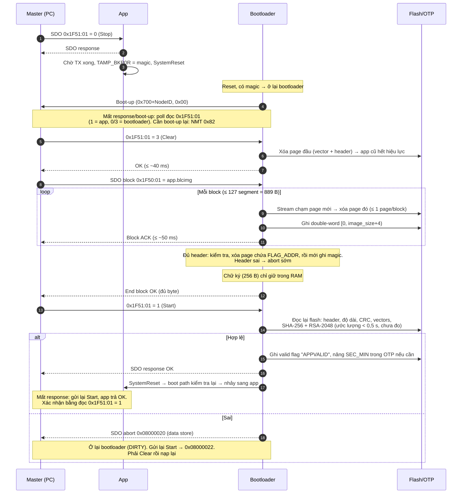

# Bootloader CANopen cho STM32G4

Thiết kế chi tiết: [docs/design.md](docs/design.md).

## Cấu trúc

```
common/              Thư viện BLC (BootLoader Common), dùng chung app + bootloader.
                     Mọi hàm/kiểu/macro có prefix blc_ / BLC_, header nằm trong blc/
  include/blc/
    blc_layout.h       Phân vùng flash theo dòng chip (dùng được trong linker script)
    blc_app_header.h   app_header_t, valid flag, kiểm tra header, blc_app_header_in_flash()
    blc_config.h       Lưu config dạng log append trong 1 page flash
    blc_config_ids.h   ID cấu hình + giá trị mặc định (NodeID, bitrate)
    blc_identity.h     Identity CANopen 0x1000/0x1018 + serial (CRC32 của UID)
    blc_boot.h         App -> bootloader qua backup register TAMP_BKP0R
    blc_secver.h       Bộ đếm chống rollback SEC_MIN trong OTP
    blc_flash.h        Ghi/xóa flash, đọc có kiểm tra ECC (NMI hook)
    blc_crc.h          CRC-32 (khối CRC phần cứng) / CRC-8
  blc_common.mk        Fragment cho Makefile
  CMakeLists.txt       Target `blc_common` cho dự án CMake
bootloader/          Firmware bootloader (kích thước vùng: `BLC_BOOTLOADER_SIZE`)
  src/board.h          Chân CAN, tần số HSE  <-- chỉnh theo board
tools/blc_image.py   Ký image, xuất public key, xem header
examples/app/        Ví dụ tích hợp vào app + linker script mẫu
tests/               Test trên PC (flash giả, mô phỏng quy trình nạp CiA 302-3)
third_party/         Submodule chính gốc của ST: cmsis_core, cmsis_device_g4,
                     stm32g4xx_hal_driver (chỉ dùng phần LL)
docs/                Tài liệu (design.md: thiết kế chi tiết)
```

## Chuẩn bị

```sh
git submodule update --init --depth 1
pip install cryptography            # cho tools/blc_image.py
python3 tools/blc_image.py keygen --out keys/dev   # khóa dev (private key bị .gitignore)
```

> Khóa production phải sinh và giữ ở nơi an toàn (HSM / máy ký riêng). Bootloader
> chỉ nhúng public key: `make PUBKEY=<đường dẫn>/prod_public.pem`.

## Build bootloader

```sh
make -C bootloader MCU=STM32G474xx      # hoặc STM32G431xx, STM32G491xx, ...
# -> bootloader/build/STM32G474xx/bootloader.{elf,bin,hex}
```

Ghi đè giá trị mặc định khi cần, ví dụ:
`make -C bootloader EXTRA_CFLAGS="-DBLC_CFG_DEFAULT_NODE_ID=10 -DBOARD_HSE_HZ=24000000"`.

**G47x/G48x:** option byte `DBANK` phải bằng `0`. Nếu không, bootloader không
nhảy sang app và từ chối Clear (abort `0x06060000`), để tránh xóa nhầm page.

## Test trên PC

```sh
make -C tests
```

- `test_config`: ghi/đọc, giá trị không đổi thì không ghi, page đầy thì gom lại,
  lỗi ECC ở ô cuối (mất điện lúc append) hoặc ở giữa page (mất điện lúc xóa),
  giá trị ngoài miền thì dùng mặc định.
- `test_sim`: master giả chạy toàn bộ quy trình Clear → nạp (block có CRC, có
  mất segment; segmented) → Start. Kiểm tra valid flag, CRC sai, sai khóa ký,
  nạp dở, file thừa/thiếu byte, chống rollback qua OTP, hết entry OTP, SDO timeout,
  xóa lazy (Clear chỉ xóa 1 page, nạp đè firmware cũ, flag `APPVALID` cũ sót lại
  đúng `FLAG_ADDR` không được nhận, hủy giữa chừng rồi nạp lại).

Test tự sinh cặp khóa riêng trong `tests/build/` (không dùng `keys/`).

## Tích hợp vào app

Xem [examples/app/blc_app_glue.c](examples/app/blc_app_glue.c). Tóm tắt:

1. Thêm thư viện: `include common/blc_common.mk` (Makefile) hoặc
   `add_subdirectory(common)` (CMake), define dòng chip (`-DSTM32G474xx`).
2. Linker: `FLASH ORIGIN = BLC_APP_START`, thêm section `.app_header` gồm 28 byte 0
   tại `ORIGIN(FLASH) + 0x200` (mẫu: [examples/app/stm32g4_app.ld.S](examples/app/stm32g4_app.ld.S)).
3. Không cần khai báo header trong code. Đọc header lúc runtime bằng `blc_app_header_in_flash()`.
4. `VECT_TAB_OFFSET = BLC_APP_START - 0x08000000` trong `SystemInit`.
5. `NMI_Handler` gọi `blc_flash_nmi_handler()`.
6. NodeID/bitrate: `blc_config_init()`, `blc_config_node_id()`,
   `blc_config_bitrate_idx()`. Với LSS, lưu bằng `blc_config_set_*()`.
7. `0x1F51:01`:
   - Ghi `0` (Stop): **chờ TX FIFO CAN rỗng** (SDO response đã ra bus) rồi gọi
     `blc_boot_enter_bootloader()`. Reset sớm hơn thì response bị mất.
   - Ghi `1` (Start): trả OK vì app đang chạy. Master gửi lại Start khi mất
     response của bootloader sẽ không bị báo lỗi.
   - Đọc: trả `1` (đang chạy). Bootloader trả `0`/`3`, nên master phân biệt được
     node đang ở app hay bootloader (identity `0x1018` của hai bên giống nhau).
8. Không dùng `TAMP_BKP0R` (đổi được bằng `BLC_BOOT_BKP_INDEX`).
9. Post-build:
   ```sh
   arm-none-eabi-objcopy -O binary app.elf app.bin
   python3 tools/blc_image.py sign --key keys/dev_private.pem --in app.bin --out app.blcimg \
       --app-version 1.2.3 --sec-version 0
   python3 tools/blc_image.py info --in app.blcimg --sec-min <SEC_MIN của thiết bị>
   ```
   Gửi `app.blcimg` vào `0x1F50:01`. `--sec-version` chỉ tăng cho bản vá bảo mật:
   nạp xong thiết bị sẽ không nhận bản có `security_version` thấp hơn nữa.

## Quy trình nạp (master)

1. `0x1F51:01 = 0` (Stop) → node reset vào bootloader và gửi boot-up.
2. `0x1F51:01 = 3` (Clear). Bootloader chỉ xóa page đầu (vector table + header)
   nên app cũ hết hiệu lực ngay và lệnh trả lời trong khoảng một lần xóa page
   (≤ ~40 ms). Các page sau được xóa dần khi nhận image.
3. Tải `app.blcimg` vào `0x1F50:01`. Ưu tiên SDO block (blksize 127, có CRC);
   segmented cũng hỗ trợ.
4. `0x1F51:01 = 1` (Start). Bootloader verify CRC + chữ ký RSA, ghi valid flag,
   nâng SEC_MIN nếu cần, trả response rồi reset vào app. Nếu image sai thì abort
   `0x08000020`. Nếu không có app hợp lệ hoặc nạp chưa xong thì abort `0x08000022`.



### Thời gian trả lời

| Bước | Bootloader bận tối đa | Ghi chú |
|---|---|---|
| Clear | 1 lần xóa page (~22 ms, max ~40 ms) | Timeout mặc định của master là đủ |
| Block ACK / segment response | 1 lần xóa page + ghi 1 block (~50 ms) | Block 889 B cắt qua tối đa 1 ranh giới page |
| Start | SHA-256 toàn image + RSA-2048 | **Chưa đo.** Ước lượng < 0,5 s với image 488 KB ở 150 MHz. Nên đặt timeout ≥ 1 s cho lệnh này |
| Giữa hai frame của một transfer | — | Bootloader tự abort `0x05040000` sau 2 s không nhận frame |

### Mất bản tin, khôi phục và hủy giữa chừng

Xem [design.md mục 4.2](docs/design.md#42-mất-bản-tin-và-khôi-phục) (mất bản
tin và khôi phục) và [mục 4.3](docs/design.md#43-hủy-giữa-chừng) (hủy giữa
chừng để nạp image khác).

## Các điểm cụ thể hóa / khác với design.md

| Mục | Cách làm trong code | Lý do |
|---|---|---|
| 5.3 – CRC phần cứng | `REV_IN` = byte, đưa word qua `__REV()` | Cho kết quả giống zlib, test bằng giá trị check `0xCBF43926` |
| 6.1 – CRC-8 | CRC-8/I-432-1 (poly 0x07, xorout 0x55) | Bản ghi toàn `0x00` (đã xóa) không bao giờ có CRC đúng |
| 6.3 – page lỗi | Chỉ 1 ô lỗi ECC và nằm ở cuối log: ghi `0x00` để vô hiệu, giữ config. Lỗi ở chỗ khác: xóa page, dùng mặc định | Mất điện lúc append không làm mất toàn bộ config |
| 6.4 – ID | NodeID = `0x01`, bitrate = `0x02` (chỉ số CiA 305), app dùng từ `0x10` | Ghép thẳng được với LSS |
| Clock | CPU 150 MHz (PLL từ HSI16), FDCAN chạy bằng HSE | CAN cần clock chính xác. HSE không lên thì dùng PCLK1 |
| Watchdog | Nạp lại IWDG trong main loop và các vòng lặp dài | An toàn khi IWDG được bật bằng option byte |

## Việc còn mở (TODO)

- Chốt dòng chip (design.md mục 7). Code đã hỗ trợ cả hai bảng phân vùng.
- Giá trị mặc định NodeID / bitrate: tạm đặt `127` / 250 kbit/s trong `blc_config_ids.h`.
- Hằng số identity (`blc_identity.h`): device type, vendor ID, product code, revision.
- `bootloader/src/board.h`: chân CAN, chân STBY của transceiver, tần số HSE (tạm 8 MHz).
- Khuyến nghị: bật WRP option byte cho vùng bootloader (page 0–9 trên G431/G491, 0–4 trên G474) khi sản xuất.
- Rủi ro: app hợp lệ nhưng không xử lý được Stop program thì không về được
  bootloader qua CAN. Có thể cân nhắc thêm cửa sổ chờ ngắn lúc boot.
