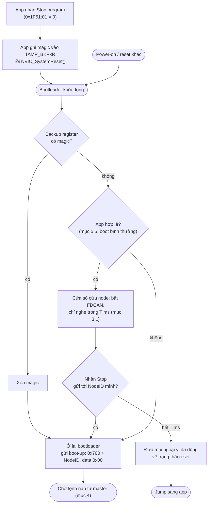
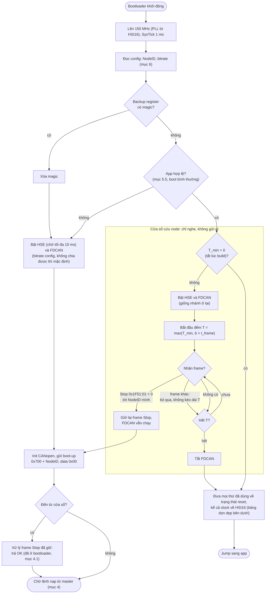
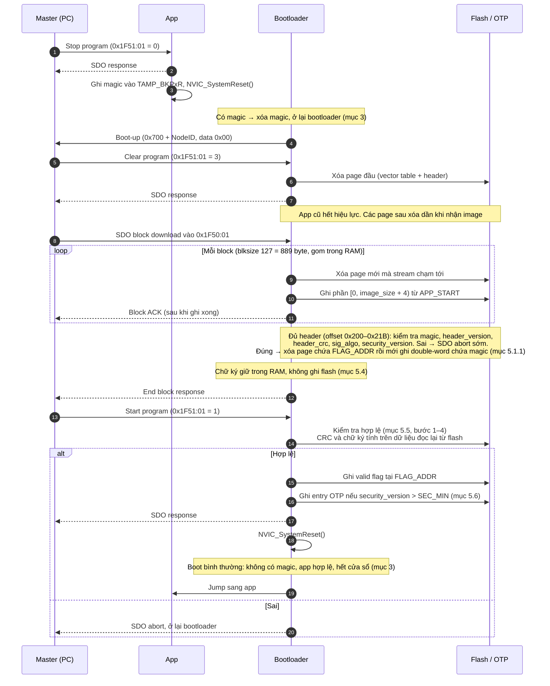
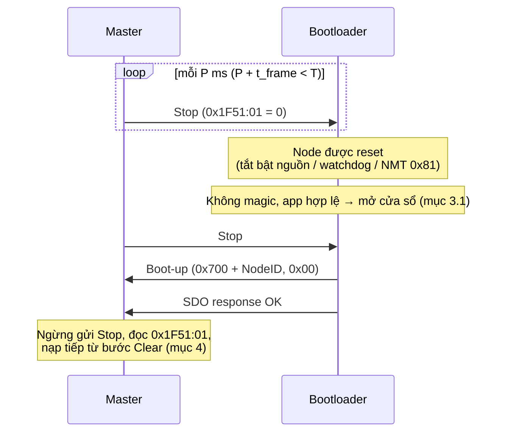
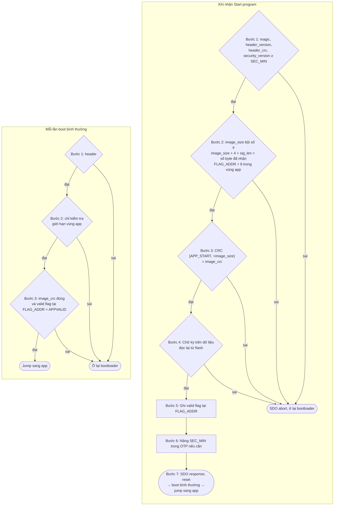

# Thiết kế Bootloader

## 1. Tổng quan

| Hạng mục | Mô tả |
|---|---|
| MCU | STM32G4x |
| Giao tiếp nạp | CANopen trên FDCAN (theo CiA 302-3, Program Download) |
| Bảo mật | Firmware được ký bằng RSA-2048 |
| NodeID | App và bootloader dùng chung NodeID, lấy từ vùng config |

## 2. Phân vùng Flash

Mỗi vùng phải nằm trọn trong các page riêng, nên phân vùng phụ thuộc vào kích thước page của từng dòng chip.

**G431 / G441 / G491 / G4A1 (page 2 KB):**

| Vùng | Địa chỉ bắt đầu | Địa chỉ kết thúc | Kích thước |
|---|---|---|---|
| Bootloader | `0x0800_0000` | `0x0800_4FFF` | 20 KB (10 page) |
| Config | `0x0800_5000` | `0x0800_57FF` | 2 KB (1 page) |
| Application | `0x0800_5800` | Cuối flash | Tùy dòng chip |

**G47x / G48x, single-bank `DBANK = 0` (page 4 KB):**

| Vùng | Địa chỉ bắt đầu | Địa chỉ kết thúc | Kích thước |
|---|---|---|---|
| Bootloader | `0x0800_0000` | `0x0800_4FFF` | 20 KB (5 page) |
| Config | `0x0800_5000` | `0x0800_5FFF` | 4 KB (1 page) |
| Application | `0x0800_6000` | Cuối flash | Tùy dòng chip |

- Vùng config lưu cấu hình dùng chung cho cả app và bootloader.
- `APP_START` (`0x0800_5800` hoặc `0x0800_6000`) căn theo page, đủ để đặt `SCB->VTOR`.
- `APP_START`, `CONFIG_START` và `PAGE_SIZE` là hằng số theo dòng chip, đặt trong file header dùng chung cho app và bootloader. Linker script của app cũng dùng cùng giá trị.
- Với G47x/G48x phải giữ option byte `DBANK = 0`. Nếu chuyển sang dual-bank thì page đổi thành 2 KB và phân vùng sẽ sai.

## 3. Chuyển từ App sang Bootloader

1. App nhận lệnh **Stop program** (ghi `0x1F51:01 = 0`) và trả SDO response.
2. App chờ tới khi SDO response đã thực sự ra bus (TX FIFO của FDCAN rỗng), rồi ghi một giá trị magic vào backup register (`TAMP_BKPxR`) và gọi `NVIC_SystemReset()`. Reset sớm hơn thì response bị mất.
3. Bootloader khởi động và đọc backup register:
   - **Có magic:** xóa magic, ở lại bootloader và gửi boot-up message (`0x700 + NodeID`, data `0x00`).
   - **Không có magic:** kiểm tra app hợp lệ (mục 5). Nếu không hợp lệ thì ở lại bootloader. Nếu hợp lệ thì mở cửa sổ cứu node (mục 3.1): bắt được lệnh Stop thì ở lại bootloader, hết cửa sổ thì dọn ngoại vi đã dùng rồi jump sang app.



> Backup register giữ được giá trị qua system reset. Trước khi ghi cần bật clock PWR và set bit `DBP` (`PWR_CR1`) để mở quyền ghi backup domain.

**App xử lý `0x1F51:01`:**

| Truy cập | App làm gì |
|---|---|
| Ghi `0` (Stop) | Chuyển về bootloader như trên |
| Ghi `1` (Start) | Trả OK, vì app đang chạy rồi. Nhờ vậy master gửi lại Start khi mất response của bootloader (mục 4.2) sẽ không bị báo nạp lỗi |
| Ghi `3` (Clear) | SDO abort `0x08000022`. Phải Stop về bootloader trước |
| Đọc | `1` (program started). Bootloader trả `0` hoặc `3` (mục 4.1), nên master phân biệt được node đang ở app hay bootloader. `0x1018` không dùng được cho việc này vì identity của hai bên giống hệt nhau |

### 3.1 Cửa sổ cứu node

Nếu chỉ có cơ chế ở trên thì app phải tự xử lý Stop thì node mới về được bootloader. App vẫn hợp lệ (đúng CRC, có valid flag) nhưng bị treo, CAN không chạy, hoặc không xử lý `0x1F51` thì không cứu được qua CAN nữa. Khi chip ở RDP1, debugger cũng không cứu được, vì xóa flash hay ghi backup register đều bị chặn. Lối ra duy nhất còn lại là hạ RDP, mà việc đó sẽ mass erase cả bootloader.

Cửa sổ cứu node bịt lỗ hổng này: chỉ cần reset được node (tắt bật nguồn, watchdog, NMT `0x81`) trong lúc master gửi Stop liên tục (mục 4.4) là node ở lại bootloader, dù app hỏng kiểu gì.

**Luồng boot đầy đủ:**



- Magic được đọc và xóa sau khi đã lên clock và đọc config. Nếu node bị reset giữa chừng (mất điện, watchdog lúc đang sửa page config) thì magic vẫn còn, yêu cầu ở lại bootloader không bị mất.

**Hành vi trong cửa sổ:**
- Cửa sổ chỉ mở ở nhánh "không có magic, app hợp lệ", ngay trước khi jump. Khi có magic hoặc app không hợp lệ thì không có cửa sổ, luồng giữ nguyên.
- Bootloader đọc NodeID và bitrate từ config (mục 6) giống nhánh ở lại, rồi bật FDCAN ở chế độ normal.
- Bootloader **không gửi gì**: không boot-up, không heartbeat. FDCAN vẫn ACK frame như mọi node khác. Nhìn từ bus, một lần boot bình thường vẫn chỉ có một boot-up, là của app.
- Chỉ chấp nhận một loại frame: SDO request (`0x600 + NodeID`, DLC 8), expedited download ghi `0x1F51:01 = 0`. Byte lệnh là `0x2F` (báo kích thước 1 byte) hoặc `0x22` (không báo kích thước), byte data đầu tiên bằng `0`. Đó đúng là các lệnh Stop mà SDO server của bootloader trả OK (mục 4.1). Các biến thể `0x2B`, `0x27`, `0x23` thì server và app theo chuẩn đều trả abort vì sai kích thước, nên cửa sổ cũng không nhận.
- Frame khác (NMT, SDO khác) bị bỏ qua và **không kéo dài cửa sổ**, để traffic bình thường trên bus không giữ node lại.
- **Bắt được Stop:** clock và FDCAN trong cửa sổ đã giống hệt nhánh ở lại, nên giữ nguyên FDCAN, chỉ init CANopen và gửi boot-up. Sau đó xử lý lệnh Stop vừa bắt được như một request bình thường, tức chỉ trả OK vì đã ở bootloader (mục 4.1).
- **Hết cửa sổ:** đưa mọi ngoại vi đã dùng về trạng thái reset (bảng dưới) rồi jump sang app.

**Độ dài cửa sổ T:**
- `T = max(T_min, 6 × t_frame)`. Trong đó `T_min = 20 ms`, còn `t_frame` là thời gian truyền một frame SDO dài nhất (135 bit, đã tính bit stuffing) ở bitrate đang dùng.
- Từ 50 kbit/s trở lên thì T = 20 ms. Ở 20 kbit/s T khoảng 41 ms, ở 10 kbit/s khoảng 81 ms.
- T tính từ lúc FDCAN bắt đầu tham gia bus (thoát chế độ init), không gồm thời gian khởi động clock.
- Master bắt được cửa sổ khi chu kỳ gửi Stop `P` thỏa `P + t_frame < T` (mục 4.4).

**Clock:**
- Bootloader lên 150 MHz (PLL từ HSI16) ngay khi khởi động, ở mọi nhánh. Chỉ có một cấu hình clock, nên cửa sổ và nhánh ở lại dùng chung clock và FDCAN: bắt được Stop thì không phải làm lại gì. Kiểm tra CRC lúc boot cũng nhanh hơn.
- FDCAN lấy clock từ HSE. HSI16 sai số tới ±1%, vượt dung sai bit timing của CAN (cỡ ±0.5% với điểm lấy mẫu 87.5%), nên chỉ dùng PCLK1 khi HSE không lên. HSE 8 MHz chia được mọi bitrate trong bảng CiA 305. PCLK1 150 MHz không chia được 800 kbit/s; khi đó dùng bitrate mặc định như nhánh ở lại.
- HSE chỉ bật khi cần FDCAN (cửa sổ hoặc nhánh ở lại). Chờ HSE có giới hạn thời gian ngắn (mặc định 10 ms), vì cửa sổ chạy ở mọi lần boot, nên board không có thạch anh cũng không được chờ lâu.
- Đổi lại, trước khi jump phải hạ clock về đúng trạng thái reset (bảng dưới).

**Dọn dẹp trước khi jump:** mọi thứ bootloader đã bật trên đường boot phải về đúng trạng thái reset, để app nhận chip giống như lúc vừa power-on.

| Đã dùng | Đưa về |
|---|---|
| FDCAN | Reset qua RCC, tắt clock. Tắt ngắt, xóa pending, priority về 0 |
| GPIO của CAN (RX, TX, chân STBY nếu có) | Reset port qua RCC, tắt clock port |
| Nguồn clock của FDCAN | Giá trị reset (HSE) |
| HSE | Tắt, chờ tắt hẳn, bỏ bypass |
| SysTick | Tắt, xóa bộ đếm, priority về 0, xóa pending |
| SYSCLK | Chuyển về HSI16, chờ chuyển xong. Prescaler AHB/APB về `/1` |
| Flash | Latency về 0 WS, tắt prefetch. Cache giữ bật như giá trị reset. Khóa lại sau mỗi lần ghi hoặc xóa (config có thể được sửa khi đọc, mục 6.3) |
| PLL | Tắt, chờ tắt hẳn, cấu hình PLL về giá trị reset |
| PWR, SYSCFG | Tắt clock. Voltage scaling để nguyên range 1, vốn là giá trị reset |
| NVIC | Tắt mọi ngắt, xóa mọi pending |
| CRC | Reset qua RCC, tắt clock |
| Backup domain | Đóng lại ngay sau khi đọc magic |

- **Thứ tự hạ clock:** chuyển SYSCLK về HSI16 trước, rồi mới hạ flash latency và tắt PLL. Hạ latency khi còn chạy 150 MHz thì CPU đọc flash sai.
- Thêm ngoại vi nào vào đường boot thì phải thêm vào bảng này.
- Reset FDCAN không xóa message RAM. Nội dung message RAM sau power-on vốn cũng không xác định, nên app không được dựa vào nó.

**Bật/tắt:** `T_min` cố định lúc build. `T_min = 0` thì tắt hẳn cửa sổ: không bật HSE hay FDCAN, kiểm tra app xong là dọn clock rồi jump ngay. `T_min` **không** đặt trong config page, vì app ghi được config: một app hỏng hoặc bị chiếm quyền chỉ cần ghi tắt cửa sổ là mất đúng đường cứu mà cửa sổ phải đảm bảo.

**Bảo mật:** không tệ hơn khi chưa có cửa sổ. Ai trên bus cũng đã gửi Stop cho app được, và image nạp vào vẫn phải có chữ ký. Cái mới duy nhất là giữ được node ở bootloader cả khi app đang chặn Stop, tức chỉ gây được DoS.

**Cái giá:** mỗi lần boot chậm thêm thời gian khởi động HSE, init FDCAN và T ms chờ. Đường boot nào cũng phải lên PLL rồi hạ về, nên bước hạ clock cần test riêng.

## 4. Quy trình nạp firmware (CiA 302-3)

| Bước | Master (PC) | Bootloader / App |
|---|---|---|
| 1 | Gửi **Stop program**: `0x1F51:01 = 0`. App không phản hồi thì cứu node (mục 4.4) | Nếu đang ở App thì chuyển về bootloader (mục 3) |
| 2 | Chờ boot-up message từ node. Không thấy thì poll `0x1F51:01` (mục 4.2) | Bootloader gửi boot-up |
| 3 | Gửi **Clear program**: `0x1F51:01 = 3` | Xóa page đầu (vector table + header) để app cũ hết hiệu lực. Các page sau xóa dần khi nhận image (xóa lazy) |
| 4 | Tải image vào `0x1F50:01` bằng **SDO block transfer** | Nhận dữ liệu và ghi vào flash |
| 5 | Gửi **Start program**: `0x1F51:01 = 1` | Kiểm tra CRC và chữ ký (mục 5.5). Nếu đúng: đánh dấu valid, trả SDO response rồi reset. Sau reset, bootloader kiểm tra app như boot bình thường (mục 3) rồi jump sang app. Nếu sai: báo SDO abort và ở lại bootloader |



**Lưu ý khi nhận SDO block:**
- Mỗi RX FIFO của FDCAN trên G4 chỉ có 3 phần tử. Bootloader phải lấy frame ra kịp, nên ưu tiên xử lý bằng ngắt.
- Khi ghi hoặc xóa flash, CPU bị stall (fetch từ cùng bank) và không lấy được frame ra khỏi FIFO. Vì vậy gom một block vào RAM, ghi flash (và xóa page nếu cần) **xong rồi mới gửi block ACK**. Client chỉ gửi block kế tiếp sau khi nhận ACK, nên trong lúc CPU stall không có frame nào tới. Nếu gửi ACK trước rồi mới ghi, block sau sẽ tới ngay trong lúc ghi (~10 ms/block) và tràn FIFO 3 phần tử.
- `blksize` chọn sao cho vừa buffer RAM (127 segment × 7 byte = 889 byte).
- **Xóa lazy khi Clear:** nếu xóa toàn bộ vùng app thì mất tới ~10 s (G491 đầy: 245 page × ~40 ms), master rất dễ bị SDO timeout. Vì vậy Clear chỉ xóa page đầu, các page sau được xóa khi stream chạm tới. Một block 889 byte cắt qua tối đa một ranh giới page, nên:
  - Clear trả lời sau tối đa một lần xóa page.
  - Mỗi block ACK chậm thêm tối đa một lần xóa page.
  - Master dùng được timeout SDO mặc định cho cả hai lệnh này.

### 4.1 Object dictionary của bootloader

Bootloader chỉ hỗ trợ các object bắt buộc theo CiA 301 và CiA 302-3. Riêng `0x1018` có đủ 4 sub, để master theo CiA 302-2 kiểm tra được đầy đủ identity khi node boot-up vào bootloader:

| Object | Tên | Truy cập | Theo | Ghi chú |
|---|---|---|---|---|
| `0x1000` | Device type | RO | CiA 301 | Hằng số, giống app |
| `0x1001` | Error register | RO | CiA 301 | Thường bằng `0`. Có thể bật bit 0 (generic error) khi không có app hợp lệ |
| `0x1017` | Producer heartbeat time | RW | CiA 301 | Error control dùng heartbeat, không hỗ trợ node guarding. Mặc định `0` (tắt) |
| `0x1018:00` | Identity: số sub-index | RO | CiA 301 | `4` |
| `0x1018:01` | Vendor ID | RO | CiA 301 | Giống app |
| `0x1018:02` | Product code | RO | CiA 301 | Giống app |
| `0x1018:03` | Revision number | RO | CiA 301 | Giống app |
| `0x1018:04` | Serial number | RO | CiA 301 | CRC32 của UID 96-bit của chip (`0x1FFF_7590`), app tính cùng cách |
| `0x1F50:01` | Program data | WO | CiA 302-3 | Nhận image (mục 5.4) |
| `0x1F51:01` | Program control | RW | CiA 302-3 | Ghi: `0` = Stop (đã ở bootloader nên chỉ trả OK), `1` = Start, `3` = Clear. Đọc: `0` = có app hợp lệ (đang đứng ở bootloader), `3` = không có app hợp lệ. App trả `1` (mục 3) |

- Các hằng số của `0x1000` và `0x1018:01–03`, cùng hàm tính serial number, đặt trong file header/source dùng chung với app. Như vậy identity của bootloader và app luôn giống hệt nhau.
- Không hỗ trợ (đều là tùy chọn): `0x100A`, `0x1F56`, `0x1F57`.
- Bootloader **không hỗ trợ LSS** (CiA 305). Nếu cần LSS thì app làm, rồi ghi NodeID/bitrate vào config. Bootloader chỉ đọc config.

### 4.2 Mất bản tin và khôi phục

Mọi lệnh trong quy trình đều gửi lại được (idempotent). Khi mất bản tin, master chỉ cần gửi lại hoặc poll, không cần biết chính xác bản tin nào đã mất.

| Sự cố | Trạng thái node | Master làm gì |
|---|---|---|
| App không phản hồi Stop (treo, CAN không chạy, không xử lý `0x1F51`) | Ở app | Cứu node (mục 4.4) |
| Mất response của Stop | Đã ở bootloader | Gửi lại Stop (bootloader trả OK) hoặc đọc `0x1F51:01` |
| Mất boot-up | Ở bootloader, heartbeat mặc định tắt | Poll đọc `0x1F51:01` tới khi ra `0`/`3`. Muốn nhận lại boot-up thì gửi NMT `0x82` (Reset Communication) |
| Timeout ở Clear | Đã hoặc đang xóa page đầu | Gửi lại Clear. Page đã trống thì không xóa lại |
| Mất block ACK, lỗi giữa chừng | Transfer dở | Gửi SDO abort → Clear → nạp lại |
| Mất response OK của Start | Đã reset sang app | Gửi lại Start (app trả OK, mục 3). Xác nhận bằng đọc `0x1F51:01 = 1` |
| Mất abort của Start | Bootloader, nạp hỏng | Gửi lại Start sẽ nhận `0x08000022`. Clear rồi nạp lại |

- Bootloader chỉ gửi boot-up **một lần**, nên master không được coi boot-up là điều kiện bắt buộc. Nên chờ boot-up một khoảng ngắn, nếu không thấy thì chuyển sang poll.
- **Chỉ gửi NMT `0x81` (Reset Node) riêng lẻ khi muốn node về app.** Magic đã bị xóa từ lần boot trước, nên nếu app cũ còn hợp lệ (chưa Clear) thì hết cửa sổ node sẽ nhảy về app. Dùng `0x81` kèm gửi Stop liên tục (mục 4.4) thì node mới ở lại bootloader.
- Trong lúc một transfer `0x1F50` đang dở, nếu quá 2 s không nhận được frame nào thì bootloader tự abort (`0x05040000`) và coi như nạp hỏng.
- Lệnh Start thường lâu hơn các lệnh khác, vì phải tính SHA-256 trên toàn bộ image và verify RSA (mục 5.5). Master nên đặt timeout riêng cho Start, dài hơn timeout mặc định.

### 4.3 Hủy giữa chừng

Master hủy được ở bất kỳ bước nào để nạp image khác:

| Đang ở bước | Cách hủy |
|---|---|
| Sau Stop, chưa Clear | Start để quay về app cũ (app còn hợp lệ thì bootloader trả OK rồi reset vào app), hoặc Clear để nạp bản khác |
| Đang nhận SDO block | **Gửi SDO abort trước.** Theo CiA 301, trong pha nhận block mọi frame khác đều bị coi là segment, nên gửi thẳng lệnh mới sẽ không có tác dụng |
| Đang nhận SDO segmented | Gửi SDO abort, hoặc gửi luôn request mới (request mới hủy transfer cũ) |
| Nhận xong, chưa Start | Clear |
| Start bị abort | Clear |
| Đang Clear | Không hủy được, phải chờ lệnh xong |

- Sau khi hủy, node coi như nạp hỏng: phải Clear thì mới nạp lại được.
- Sau Clear thì không quay về app cũ được, vì chỉ có một vùng app, không có bản sao lưu. Mất điện lúc này thì node vẫn đứng ở bootloader (không có app hợp lệ), nên luôn nạp lại được.

### 4.4 Cứu node

Master dùng thao tác này khi app không phản hồi Stop. Nó cũng dùng được khi app còn chạy tốt (app nhận Stop thì tự về bootloader như mục 3), nên master có thể luôn bắt đầu nạp theo cách này mà không phải phân biệt hai trường hợp.

1. Gửi Stop (`0x1F51:01 = 0`, byte lệnh `0x2F`) đều đặn, chu kỳ `P` thỏa `P + t_frame < T` (mục 3.1). Mặc định T = 20 ms, P = 5 ms. Ở 20 kbit/s và 10 kbit/s chọn P lớn hơn nhưng vẫn thỏa điều kiện, ví dụ P = 20 ms.
2. Reset node bằng bất cứ cách nào có được: tắt bật nguồn, chờ watchdog, hoặc NMT `0x81` nếu app còn xử lý NMT.
3. Khi thấy boot-up hoặc SDO response OK cho Stop thì ngừng gửi Stop và bỏ các Stop còn trong hàng đợi TX của adapter. Mỗi Stop đã ra bus đều được trả OK, nên master bỏ qua các response thừa.
4. Xác nhận node đã ở bootloader bằng đọc `0x1F51:01` (`0` hoặc `3`, mục 4.1), rồi nạp tiếp từ bước Clear (mục 4).



**Vì sao cửa sổ ngắn vẫn bắt được Stop:**
- **Bus chỉ có master và node:** lúc node đang reset thì không ai ACK frame Stop, nên adapter của master tự gửi lại liên tục (hành vi mặc định của CAN). Bootloader vừa tham gia bus là thấy frame đó ngay.
- **Bus có nhiều node:** node khác ACK frame Stop nên master không tự gửi lại. Khi đó chỉ còn dựa vào việc master gửi đều đặn với chu kỳ P.
- Một số adapter chạy chế độ one-shot (không tự gửi lại), nên master **luôn** phải gửi Stop đều đặn, không dựa vào việc tự gửi lại.

**Tải bus:** gửi Stop mỗi 5 ms chiếm khoảng 20% bus ở 125 kbit/s và 10% ở 250 kbit/s. Chỉ gửi trong lúc cứu node và ngừng ngay khi node đã về bootloader.

## 5. Định dạng image và kiểm tra hợp lệ

### 5.1 Bố cục image

```
APP_START (mục 2)
├── 0x000  Vector table
├── 0x200  app_header_t (APP_START + 0x200)
├── ...    Code / data của app (đệm 0xFF cho tròn bội số 4 byte)
├── image_crc  (uint32, tại APP_START + image_size)
└── Valid flag (8 byte, tại ALIGN8(APP_START + image_size + 4), do bootloader ghi)
```

File image mà master gửi qua `0x1F50` gồm: **image + `image_crc` + chữ ký**. Chữ ký chỉ dùng để verify, nên bootloader giữ nó trong RAM và **không ghi vào flash**.

- Header đặt ở offset cố định `0x200` qua section `.app_header` trong linker script của app. Linker script chỉ chừa 28 byte 0, tool post-build điền toàn bộ các trường (`app_version`, `security_version` lấy từ tham số dòng lệnh).
- `image_size` tính từ `APP_START` đến hết app (có cả vector table và header). **Không** gồm `image_crc`. Phải là bội số của 4 để `image_crc` được căn 4 byte.
- `image_crc` nằm ngay sau image.

### 5.1.1 Valid flag

- **Địa chỉ:** `FLAG_ADDR = ALIGN8(APP_START + image_size + 4)`, tức double-word đầu tiên sau `image_crc`.
  - Phải căn 8 vì flash G4 ghi theo double-word 64-bit có ECC.
  - Nếu double-word chứa `image_crc` chỉ được ghi một phần (phần còn lại đệm `0xFF`) thì double-word đó không ghi lại được nữa. Căn lên 8 đảm bảo flag luôn nằm ở một double-word còn trống.
- **Không có trong file image.** Master không gửi flag. Bootloader tự ghi sau khi đã kiểm tra hết (mục 5.5).
- **Giá trị:**
  - Valid: `0x44494C41_56505041`, byte trong flash là `"APPVALID"`. Bootloader so khớp đủ 8 byte.
  - Chưa valid: `0xFFFF_FFFF_FFFF_FFFF` (flash đã xóa).
  - Thu hồi (tùy chọn): ghi toàn bộ `0x00`.
- **Không bao giờ đi cùng header của image mới nạp dở.** Clear chỉ xóa page đầu, nên `APPVALID` của image cũ có thể còn sót ở page sau. Vì vậy khi nhận đủ header, bootloader xóa page chứa `FLAG_ADDR` của image mới **trước**, rồi mới ghi double-word chứa `magic`. Mất điện ở bất kỳ thời điểm nào cũng không để lại header hợp lệ kèm flag cũ.
- Cách này không dùng tới vùng config. Mất config cũng không làm mất trạng thái valid của app.

### 5.2 Cấu trúc header

```c
typedef struct __attribute__((packed)) {
    uint32_t magic;          // 0x00: 0x48534450 (byte trong flash: "PDSH")
    uint16_t header_version; // 0x04: phiên bản định dạng header
    uint16_t sig_algo;       // 0x06: thuật toán ký xác thực
    uint32_t app_version;      // 0x08: major<<24 | minor<<16 | patch
    uint32_t security_version; // 0x0C: phiên bản bảo mật, chống rollback (mục 5.6)
    uint32_t build_time;       // 0x10: Unix time (giây, UTC)
    uint32_t image_size;       // 0x14: kích thước image (byte), bội số của 4
    uint32_t header_crc;       // 0x18: CRC32 của byte 0x00–0x17 của header
} app_header_t;                // 28 byte, little-endian
```

`image_crc` không nằm trong header mà ở cuối image (mục 5.1).

**`app_version` và `security_version`:**
- `app_version` chỉ để hiển thị và quản lý. Bootloader **không** hạn chế nạp bản cũ hơn theo trường này.
- `security_version` chỉ tăng khi bản mới vá một lỗ hổng bảo mật. Các bản không vá bảo mật giữ nguyên giá trị, nên vẫn hạ phiên bản qua lại được. Bản build đầu tiên dùng `0`.

**`sig_algo`:**

| Giá trị | Thuật toán | Bootloader bản đầu |
|---|---|---|
| `0x0001` | RSA-2048, SHA-256, PKCS#1 v1.5 | **Hỗ trợ** |
| `0x0002` | RSA-2048, SHA-256, PSS | Giữ chỗ, từ chối |
| Khác | Không định nghĩa | Từ chối |

- Bootloader chỉ chấp nhận các giá trị nằm trong danh sách mình hỗ trợ. **Không có giá trị nào nghĩa là "không ký"**, để không ai bỏ qua bước xác thực bằng cách sửa trường này.
- `sig_algo` cũng quyết định độ dài chữ ký ở cuối file image.

**Cách verify PKCS#1 v1.5:**
- Public exponent cố định `e = 65537`, hard-code trong bootloader cùng với modulus `n`.
- Tính `m = sig^e mod n`, rồi so `memcmp` nguyên khối 256 byte với chuỗi mong đợi do bootloader tự dựng: `00 01 FF…FF 00 || DigestInfo(SHA-256) || hash`.
- **Không parse ASN.1 hay padding từ chữ ký.** Cách dựng rồi so nguyên khối này chặn được tấn công giả chữ ký kiểu Bleichenbacher 2006.

### 5.3 Phạm vi các CRC và chữ ký

| Trường | Phạm vi tính |
|---|---|
| `header_crc` | 24 byte đầu của header (`magic` … `image_size`) |
| `image_crc` | Liền một mạch `[APP_START, APP_START + image_size)`, có cả header đã điền `header_crc` |
| Chữ ký | Mọi byte đứng trước nó: `[APP_START, APP_START + image_size + 4)`, tức image + `image_crc` |

- CRC32 dùng đa thức `0x04C11DB7`, init `0xFFFFFFFF`, đảo bit vào/ra, XOR cuối `0xFFFFFFFF` (giống CRC-32 của zlib). Tính bằng khối CRC phần cứng của G4: cấu hình `REV_IN` = byte, `REV_OUT` = 1, XOR cuối làm bằng phần mềm.
- Chữ ký phủ cả header, nên muốn sửa `sig_algo`, `security_version`… mà không làm hỏng chữ ký là không thể.
- Tool post-build trên PC lần lượt: đệm image cho tròn bội số 4 → điền toàn bộ header (`magic`, `header_version`, `sig_algo`, `app_version`, `security_version`, `build_time`, `image_size`) → tính `header_crc` → tính `image_crc` rồi nối vào cuối → ký → nối chữ ký vào cuối file.

### 5.4 Nhận image qua `0x1F50`

Bootloader nhận stream liên tục và chia theo offset:

| Offset trong stream | Xử lý |
|---|---|
| `[0, image_size + 4)` | Ghi vào flash từ `APP_START` |
| `[image_size + 4, image_size + 4 + sig_len)` | Copy vào buffer RAM (256 byte với RSA-2048) |
| Vượt quá | SDO abort |

- `image_size` và `sig_algo` lấy từ header. Header nằm ở offset `0x200–0x21B`, tới sớm trong stream, nên bootloader biết được ranh giới trước khi tới phần chữ ký.
- Khi nhận đủ header, kiểm tra ngay `magic`, `header_version`, `header_crc`, `sig_algo` và `security_version` (mục 5.6). Sai thì abort sớm, không cần chờ hết stream.

### 5.5 Kiểm tra hợp lệ

**Khi nhận lệnh Start program (sau khi nạp):**
1. Kiểm tra `magic` và `header_version` có hỗ trợ không, kiểm tra `header_crc`, kiểm tra `security_version ≥ SEC_MIN` (mục 5.6).
2. Kiểm tra `image_size` là bội số của 4. Kiểm tra `image_size + 4 +` độ dài chữ ký bằng số byte đã nhận qua `0x1F50`, và `FLAG_ADDR + 8` không vượt vùng app.
3. Tính CRC trên `[APP_START, APP_START + image_size)`, so với `image_crc` đọc tại `APP_START + image_size`.
4. Verify chữ ký trong buffer RAM theo `sig_algo`, tính trên dữ liệu **đọc lại từ flash** (`[APP_START, APP_START + image_size + 4)`). Như vậy là xác thực đúng những gì đã thực sự ghi vào flash. Public key lưu trong bootloader.
5. Cả 4 bước đều đạt thì ghi valid flag tại `FLAG_ADDR`.
6. Nếu `security_version > SEC_MIN` thì ghi entry mới vào OTP (mục 5.6).
7. Trả SDO response cho Start program rồi reset. Sau reset, bootloader kiểm tra như boot bình thường (bên dưới), mở cửa sổ cứu node (mục 3.1) rồi mới jump sang app. Không jump thẳng từ lúc đang chạy CANopen: đường boot bình thường chỉ dùng một tập ngoại vi nhỏ và có danh sách dọn dẹp rõ ràng (mục 3.1), nên app luôn khởi động với clock và ngoại vi ở trạng thái reset, giống hệt khi power-on. Code HAL của app hay giả định điều này.

**Mỗi lần boot bình thường:** chạy lại bước 1–2 (bước 2 chỉ kiểm tra giới hạn vùng app, vì lúc này không có số byte đã nhận). Bước 3 gồm hai điều kiện: `image_crc` đúng và valid flag tại `FLAG_ADDR` bằng `APPVALID`. Valid flag thay cho bước 4, nên không verify lại chữ ký.



**Ghi chú:**
- G4 không có khối HASH/PKA, nên SHA-256 và RSA phải làm bằng phần mềm. Cần chọn thư viện gọn để vừa 20 KB.

### 5.6 Chống rollback bằng `security_version`

Mức tối thiểu `SEC_MIN` lưu trong OTP, để không bị mất khi mass erase, hạ RDP hay mất config.

**Vùng OTP dành cho bộ đếm:** 32 double-word đầu, `0x1FFF_7000–0x1FFF_70FF` (256 byte). Phần OTP còn lại để dùng cho việc khác.

**Mỗi entry (8 byte):**

| Byte | Nội dung |
|---|---|
| 0–3 | `security_version` |
| 4–7 | `~security_version` (đảo bit, để kiểm tra entry hợp lệ) |

**Đọc `SEC_MIN`:**
- Quét 32 entry. Entry toàn `0xFF` là còn trống.
- Entry hợp lệ là entry có byte 4–7 đúng bằng đảo bit của byte 0–3.
- `SEC_MIN` = giá trị lớn nhất trong các entry hợp lệ. Không có entry nào hợp lệ thì `SEC_MIN = 0`.
- Entry bị lỗi ECC (mất điện lúc ghi, gây NMI như mục 6.3) hoặc không hợp lệ thì bỏ qua và coi như đã dùng.

**Ghi `SEC_MIN` mới:**
- Bootloader tự nâng mức, chỉ sau khi image mới đã qua hết các bước kiểm tra và đã ghi valid flag (mục 5.5, bước 6).
- Ghi vào entry trống đầu tiên. Mỗi lần ghi có thể nhảy nhiều mức, ví dụ từ `0` lên thẳng `3`.
- Hết 32 entry thì không nâng được nữa. Bootloader vẫn chạy app bình thường, chỉ không tăng `SEC_MIN`, và không được ghi tràn sang vùng OTP khác.

**Lưu ý vận hành:**
- Một khi đã nạp bản có `security_version` cao hơn thì **không quay về được** bản có giá trị thấp hơn. Chỉ tăng trường này cho bản vá bảo mật, và phải test kỹ trước khi phát hành.
- Quy trình nạp xóa app (Clear program) **trước** khi nhận header. Nếu image bị từ chối vì `security_version` thấp, thiết bị sẽ đứng ở bootloader và không có app. Tool trên PC nên đọc header của file và cảnh báo trước khi nạp.

## 6. Cơ chế lưu config

### 6.1 Cấu trúc bản ghi (8 byte = 1 double-word flash)

| Byte | Nội dung |
|---|---|
| 0 | Tag: `0xFF` = ô trống, `0x00` = ô đã xóa, giá trị khác = ID cấu hình |
| 1–6 | Data (mỗi cấu hình tối đa 6 byte) |
| 7 | CRC-8 của byte 0–6 |

- Flash G4 ghi theo đơn vị 64-bit có ECC, nên mỗi bản ghi khớp đúng một lần ghi.
- Không bắt buộc đánh dấu bản ghi cũ là "đã xóa": khi đọc, bản ghi hợp lệ cuối cùng của mỗi ID đã được ưu tiên. Nếu muốn đánh dấu (tùy chọn) thì ghi cả 8 byte = `0x00`. Đây là trường hợp duy nhất flash G4 cho phép ghi đè một double-word đã ghi.

### 6.2 Quy tắc đọc và ghi

- **Ghi:** append bản ghi mới vào ô trống đầu tiên.
- **Đọc:** quét cả page, lấy bản ghi hợp lệ (CRC đúng) **cuối cùng** của mỗi ID.
- **Page đầy:** gom bản ghi mới nhất của từng ID, xóa page rồi ghi lại.
- **Không tìm thấy hoặc bị hỏng:** dùng giá trị mặc định hard-code trong firmware. "Hỏng" gồm 2 trường hợp:
  - Không có bản ghi nào của ID đó có CRC đúng.
  - Giá trị nằm ngoài miền hợp lệ: NodeID ngoài `1–127`, hoặc bitrate không thuộc danh sách hỗ trợ.
- Giá trị mặc định đặt trong một file header dùng chung cho app và bootloader, để hai bên luôn giống nhau.

### 6.3 Rủi ro mất điện khi gom page

Chỉ dùng 1 page để tiết kiệm flash. Như vậy chấp nhận rủi ro mất config nếu mất điện đúng lúc xóa page và ghi lại (thời gian xóa 1 page cỡ vài chục ms). Rủi ro được giảm như sau:

- **Ít khi phải gom page:** 1 page chứa được 256 bản ghi (page 2 KB) hoặc 512 bản ghi (page 4 KB). Chỉ ghi khi giá trị thực sự thay đổi, nên page rất lâu mới đầy.
- **Gom trong RAM:** đọc bản ghi mới nhất của từng ID vào RAM, xóa page rồi ghi lại ngay, giữ cửa sổ rủi ro ngắn nhất có thể.
- **Luôn khôi phục được:** nếu mất config thì mọi cấu hình về mặc định, kể cả NodeID và bitrate. Master vẫn kết nối lại được qua NodeID/bitrate mặc định để cấu hình lại.
- **Xử lý page bị hỏng do xóa dở:** đọc ô flash bị lỗi ECC 2-bit sẽ gây NMI (`FLASH_ECCR.ECCD`). Code đọc config phải bắt NMI này hoặc kiểm tra ECC. Nếu page lỗi thì xóa page và dùng mặc định.

### 6.4 Danh sách cấu hình

| ID | Cấu hình | Dùng bởi | Mặc định |
|---|---|---|---|
| TBD | CAN NodeID | App + Bootloader | TBD |
| TBD | CAN Bitrate | App + Bootloader | TBD |

## 7. Vấn đề cần chốt

- [x] Chế độ bank → G47x/G48x dùng single-bank, phân vùng theo page 4 KB (mục 2).
- [ ] Dòng chip G4 cụ thể (để chọn bảng phân vùng ở mục 2).
- [x] Định dạng image và vị trí header (mục 5).
- [x] Bootloader bản đầu hỗ trợ `sig_algo` nào → chỉ PKCS#1 v1.5 (`0x0001`). PSS giữ chỗ cho sau này (mục 5.2).
- [x] Giá trị `magic` → `0x48534450` ("PDSH"). Valid flag → `0x44494C4156505041` ("APPVALID").
- [x] Mỗi lần boot có verify lại chữ ký không → **Không**, chỉ kiểm tra cờ valid + CRC (mục 5).
- [x] Hành vi khi NodeID hoặc bitrate trong config bị hỏng → dùng giá trị mặc định hard-code (mục 6.2).
- [ ] Giá trị mặc định của NodeID và bitrate (mục 6.4).
- [x] Có hỗ trợ `0x1F56` (software identification) và `0x1F57` (flash status) không → **Không**, chỉ hỗ trợ object bắt buộc (mục 4.1).
- [x] Có cơ chế chống rollback không → **Có**, dùng `security_version` + bộ đếm trong OTP. `app_version` không bị hạn chế (mục 5.6).
- [x] Cứu node khi app hợp lệ nhưng không phản hồi Stop → **Có**, cửa sổ chỉ nghe lúc boot, `T = max(20 ms, 6 × t_frame)`, SYSCLK lên 150 MHz ngay từ đầu, FDCAN chạy từ HSE (mục 3.1, 4.4).
- [x] Bật/tắt cửa sổ → cố định lúc build (`T_min = 0` để tắt), không đặt trong config (mục 3.1).
- [x] Lệnh Stop nào được nhận trong cửa sổ → byte lệnh `0x2F` và `0x22`, giống SDO server của bootloader (mục 3.1).
- [ ] Đo thời gian boot thêm (khởi động HSE, init FDCAN) trên board thật.
